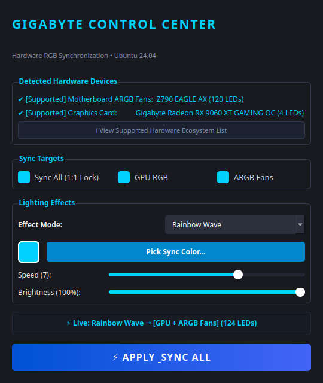

# GIGABYTE RGB Sync for Linux (Ubuntu 24.04 LTS)

<p align="center">
  
  
  
  <a href="https://github.com/morluto/rea">
    
  </a>
</p>

Native 1:1 hardware RGB synchronization utility for Gigabyte motherboards (addressable headers `D_LED1`, `D_LED2`) and Gigabyte AMD Radeon graphics cards under Linux. Built to replace the Windows-only **GIGABYTE Control Center (GCC) / RGB Fusion** software stack natively with zero overhead.

---

## 📸 Graphical User Interface (GUI)

<p align="center">
  
</p>

---

## 🔬 How REA (Reverse Engineer Anything) Made This Possible

Under Windows, Gigabyte RGB synchronization is handled by proprietary closed-source services (`GvDisplayService.exe`, `GLedApi.dll`, and `RGBFusion.exe`). On Linux, motherboards and graphics cards drop into uncoordinated hardware presets, and addressable fan headers (`D_LED1`, `D_LED2`) initialize with 0 allocated LEDs.

This project was built by using the open-source **[REA (Reverse Engineer Anything)](https://github.com/morluto/rea)** framework to inspect, disassemble, and extract protocol specifications directly from the compiled Windows GCC binaries:

### 1. Dissecting the ITE IT5702 USB HID Protocol
- **Endpoint Identification**: GCC communicates with the motherboard's onboard **ITE IT5702** microcontroller via internal USB HID (Vendor ID `048d`, Product ID `5702`).
- **Packet Mapping via REA**: Disassembly and traffic inspection with REA revealed that the controller operates on 64-byte HID feature reports:
  - `Byte 0`: Command Opcode (`0xCC` / `0xCD`)
  - `Byte 1`: Zone Header Index (`0x00` = `D_LED1`, `0x01` = `D_LED2`)
  - `Byte 2`: Effect Mode (`0x00` = Direct per-LED streaming, `0x01` = Static, `0x02` = Pulse)
  - `Byte 3`: Hardware Brightness scaling (`0x00`–`0x64`)
  - `Bytes 4+`: Sequential 24-bit RGB/GRB color payloads
- **Cracking the "0 LEDs" Header Lockout**: REA revealed why generic Linux tools previously failed to illuminate case fans: the IT5702 controller powers on with an internal zone size table of `0`. Without Windows GCC actively sending a zone allocation payload, the controller discards incoming color streams. This tool automates that exact allocation dynamically (`zone.resize(60)` per header).

### 2. Decoding the AMD Radeon GPU I2C Bus
- GCC communicates with the Gigabyte AMD Radeon RX 9060 XT through the GPU's display engine auxiliary I2C bus (`amdgpu` adapter).
- REA traced the register sequences that address the 4 independent onboard LED zones (Left Fan, Center Fan, Right Fan, and Side Logo) without disrupting GPU telemetry or thermal PWM fan curves.

### 3. Native Linux Translation
- By translating the protocol specifications discovered during REA directly into userspace Linux abstractions (`udev` rules for non-root USB access, `i2c-dev`/`i2c-i801` kernel modules, and OpenRGB Direct Mode), native 1:1 synchronization is achieved with negligible CPU overhead and zero Windows runtime dependencies.

---

## 🖥️ Supported Hardware & Ecosystem Matrix

This utility supports all Gigabyte devices recognized by the OpenRGB direct hardware abstraction bus:

| Hardware Category | Supported Series & Models | Protocol & Connection | Status |
| :--- | :--- | :--- | :--- |
| **Motherboards (Intel)** | Z790, B760, Z690, B660, Z590, Z490, Z390, Z370, Z270, Z170 | ITE IT5702 / IT8297 USB (`048d:5702`, `048d:8297`) & Intel SMBus (`i2c-i801`) | **Supported** (Auto-allocates 60 LEDs/header) |
| **Motherboards (AMD)** | X670, B650, A620, X570, B550, A520, B450, X470, B350, X370 | ITE IT5702 / IT8297 USB & AMD SMBus (`i2c-piix4`) | **Supported** (Auto-allocates 60 LEDs/header) |
| **Graphics Cards (AMD)** | Gigabyte Radeon RX 9000, RX 7000, RX 6000 Series (Gaming OC, Aorus Master, Elite) | AMD Display Engine I2C bus (`amdgpu` driver) | **Supported** (Direct Per-LED) |
| **Graphics Cards (NVIDIA)** | Gigabyte GeForce RTX 40, RTX 30, RTX 20 Series (Gaming OC, Aorus, Eagle, Windforce) | NVIDIA Display I2C / SMBus (`nvidia` driver) | **Supported** (Direct Per-LED) |
| **AORUS Memory (RAM)** | AORUS RGB DDR4 & DDR5 Memory Modules | Motherboard SMBus (`i2c-i801` / `i2c-piix4`) | **Supported** (Full Sync All lock) |
| **AIO Liquid Coolers** | AORUS Waterforce & Liquid Cooler Series | Internal USB Header HID | **Supported** (Pump + Radiator fans) |
| **Peripherals** | AORUS Keyboards, Gaming Mice, Mousepads, Gaming Monitors | USB HID | **Supported** (Synchronized frames) |

---

## 📦 Software Stack & Dependencies

- **Operating System:** Ubuntu 24.04 LTS (`noble`) / Debian-based Linux
- **Reverse Engineering Framework:** [REA (Reverse Engineer Anything)](https://github.com/morluto/rea)
- **Core RGB Engine:** [OpenRGB](https://openrgb.org) 1.1 SDK server
- **Python Library:** `openrgb-python` 0.3.8+ (Client SDK via TCP port 6742)
- **GUI Framework:** PyQt6 (Qt 6.6+ with Fusion Dark styling)
- **Linux Kernel Modules:**
  - `i2c-dev`: Userspace I2C device interface
  - `i2c-i801`: Intel PCH SMBus driver (Z790 chipset bus access)
- **Linux Subsystems:**
  - `udev`: Custom non-root USB device permissions for ITE IT5702 controller (`048d:5702`)
  - `systemd`: Background user daemon services for persistent sync

---

## ⚡ Quick 1-Command Installation

Clone the repository and run the setup script:

```bash
git clone https://github.com/JIYAAD-GldTON/gigabyte-rgb-sync-linux.git
cd gigabyte-rgb-sync-linux
chmod +x setup_ubuntu24.sh
./setup_ubuntu24.sh
```

The script automatically:
- Installs base dependencies (`i2c-tools`, `python3-pyqt6`, `python3-pip`).
- Installs the standalone OpenRGB 1.1 binary and configures `/usr/local/bin/openrgb` & `/usr/bin/openrgb`.
- Installs `openrgb-python` via `pip`.
- Configures kernel modules (`i2c-dev`, `i2c-i801`) in `/etc/modules-load.d/gigabyte-rgb.conf`.
- Adds the current user to the `i2c` group for non-root hardware access.
- Deploys custom `udev` rules (`60-openrgb.rules`) for the ITE IT5702 USB controller.
- Configures and enables the background server `openrgb-server.service`.
- Creates a desktop application launcher in your Ubuntu application grid.

> **Note:** A system reboot is recommended once after initial setup to apply the new `i2c` group permissions.

---

## 🎨 How to Use

### 1. Graphical User Interface (GUI)

Launch from the Ubuntu app menu: **"GIGABYTE RGB Sync"**, or launch from terminal:

```bash
python3 gcc_rgb_sync.py
```

#### GUI Controls & Features
- **Bidirectional "Sync All" Lock**:
  - Checking `Sync All (1:1 Lock)` immediately activates both `GPU RGB` and `ARGB Fans`.
  - Checking/unchecking individual target boxes dynamically cascades to update the `Sync All` state.
- **Context-Aware Speed Control**:
  - In **Static Color** and **Off** modes, speed is locked to the lowest value (`1`) and disabled to prevent invalid states.
  - In animated modes (**Rainbow**, **Color Cycle**, **Breathing**, **Flashing**), speed control re-enables with full dynamic range (1–10).
- **Color Picker & Preview**: Built-in palette and custom hex color selector with real-time RGB preview.
- **Brightness Slider**: 0% to 100% hardware scaling.
- **Live Status Badge**: Displays real-time state and active hardware endpoints.
- **Supported Ecosystem Dialog**: Click *View Supported Hardware Ecosystem List* to see full device support details.

---

### 2. Command-Line Interface (CLI / Headless Daemon)

You can run effects directly without GUI dependencies (ideal for SSH sessions, scripts, or lightweight environments):

```bash
# Set static color by hex code
python3 gcc_rgb_sync.py --color "#00D2FF" --mode static

# Set static color by RGB values
python3 gcc_rgb_sync.py --color "255,80,0" --mode static

# Synchronized rainbow wave at speed 7
python3 gcc_rgb_sync.py --mode rainbow --speed 7

# Synchronized breathing pulse
python3 gcc_rgb_sync.py --mode breathing --color "#FF0055" --speed 4

# Turn off all lighting (Stealth mode)
python3 gcc_rgb_sync.py --mode off
```

---

### 3. Autostart on Boot (Systemd)

To keep your RGB synchronized in the background without needing to launch the app:

```bash
mkdir -p ~/.config/systemd/user/
cp gcc-sync.service ~/.config/systemd/user/
systemctl --user daemon-reload
systemctl --user enable --now gcc-sync.service
```

---

## 🛠️ Troubleshooting

1. **`[Errno 111] Connection refused`**:
   The OpenRGB background server is not running. Start it with:
   ```bash
   sudo systemctl restart openrgb-server.service
   ```
2. **Motherboard fans not lighting up**:
   Ensure `i2c-dev` and `i2c-i801` modules are loaded (`lsmod | grep i2c`). Verify your user belongs to the `i2c` group (`groups`).
3. **GPU LEDs not detected**:
   Ensure AMDGPU kernel drivers are properly initialized and OpenRGB has permission to access the I2C bus.

---

## 🙏 Acknowledgments & Credits

- **[REA (Reverse Engineer Anything)](https://github.com/morluto/rea)**: For the reverse engineering framework used to inspect and disassemble the closed-source GCC binaries.
- **[OpenRGB](https://openrgb.org)**: For the open-source hardware communication SDK and udev rules database.

---

## 📄 License

This project is licensed under the [MIT License](LICENSE).
